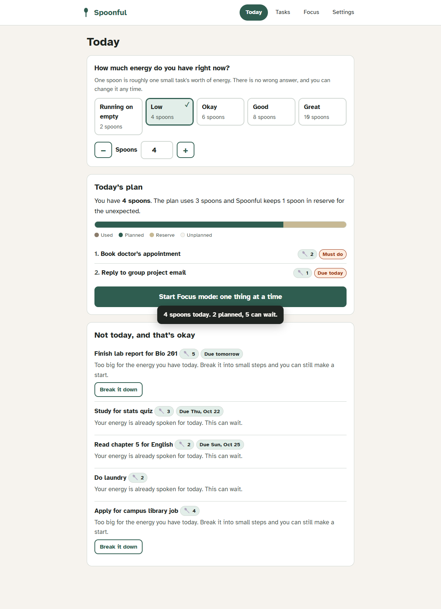

# Spoonful: plan by energy, not by hours

**An accessible, offline-first day planner for people whose energy changes from day to day.**
Tell it how many "spoons" you have today. It plans what fits, holds one spoon in reserve, and tells you kindly why everything else can wait.

> Built for the [Taskforge](https://taskforge.devpost.com/) hackathon (Oct 2026).



## The problem

Most to-do apps assume you have the same energy every day. For students with chronic illness (ME/CFS, long COVID, POTS, lupus), ADHD, depression or chronic pain, that assumption is wrong. On a bad day the list stays the same length, nothing fits, and the app shows the gap as failure.

*Spoon theory* (Christine Miserandino, 2003) gives these students a language for limited energy: each day you get a number of spoons, and every task costs some. Spoonful puts that idea into practice.

## What it does

| Feature | Why it matters |
|---|---|
| **Energy check-in** (5 presets or an exact 0–12 spoons) | Planning starts from today's real capacity, not an ideal one |
| **Energy cost per task** (Tiny 1 → Huge 5) | Tasks are measured in effort, not minutes |
| **Automatic plan**: must-do and due-soon first, then smallest first, with **1 spoon held in reserve** | The plan never spends you down to zero |
| **"Not today, and that's okay"**, with a reason for every deferred task | It explains instead of shaming. Rest days are labelled as rest |
| **Break it down**: built-in step suggestions (offline, no AI) | Big tasks become small enough that part of them fits a low day |
| **Partial planning**: "just the first 2 of 4 steps today" | Progress on big deadlines even on low-energy days |
| **Focus mode**: one thing at a time, with Done / Not now / Too big? / Read aloud, plus a count-*up* timer | Less visual overwhelm, no countdown pressure |
| **Done today + Undo** | Shows what you achieved. Mistakes are easy to fix |
| **Comfort settings**: text size, readable spacing, high contrast, dark mode, reduced motion | The user adapts the tool, not the other way around |
| **Private by default**: localStorage only, backup/restore as JSON, works offline as an installable PWA | No account, no server, no tracking. Health-adjacent data stays on the device |

## Run it

No build step and no dependencies.

```bash
# Option 1: open the file directly
open index.html            # (Windows: start index.html)

# Option 2: serve it locally (enables offline/PWA install)
npx http-server -p 8080 .  # or: python -m http.server 8080
# then visit http://localhost:8080
```

Click **"Try it with example tasks"** for a ready-made demo list.

**Deploy:** push to GitHub, then go to *Settings → Pages → Deploy from branch → main / root*. The app is fully static.

## Tests

```bash
npm test   # 16 unit tests for the planning engine (node:test, zero dependencies)
```

`tests/e2e.browser.js` drives the full user flow in headless Chrome and runs an **axe-core** WCAG 2.1 AA audit in six states (empty, planned, task panel, focus, dark, high contrast). Latest run: **0 violations, 0 console errors, no horizontal scroll at 390px.**

## How it works

```
index.html          markup, semantic landmarks, static forms
styles.css          design tokens; light, dark and high-contrast themes; text-size and readable-spacing modes
js/planner.js       pure planning engine (buildPlan, suggestSteps), shared by the browser and Node tests
js/store.js         localStorage persistence, daily reset, import/export
js/app.js           state → render(), delegated events, focus management, live-region announcements
sw.js               offline cache (app shell)
tests/              unit tests + browser e2e/accessibility test
```

**The planning algorithm** (`js/planner.js → buildPlan`):
1. `available = budget − reserve (1 if budget ≥ 4) − spoons already spent today`
2. Rank open tasks by urgency (must-do > overdue > due today > tomorrow > ≤3 days > ≤7 days), then by lowest cost, then by oldest.
3. Greedily plan each task that fits.
4. If a task doesn't fit but is due within 3 days, or is bigger than the whole day, and it has steps, plan **as many of its steps as fit**.
5. Every other task is deferred with a reason: `too-big` (offer a breakdown), `step-too-big`, `no-room`, or `rest` (when ≤1 spoon is left).

## Limitations

- Spoon estimates are self-reported and subjective. That's deliberate, but the plan is only as good as the estimate.
- Step suggestions come from keyword templates, not an understanding of the task. They're a starting point to edit.
- Data lives in one browser. There is no sync across devices; use backup/restore.
- Tested with axe-core and keyboard-only use. Not yet tested with real screen-reader users or people with chronic illness.

## License

MIT
